# Guía de Ejecución y Configuración para Colaboradores — TaleScript

Esta guía está diseñada para que cualquier desarrollador o colaborador del equipo pueda clonar el repositorio, configurar el entorno en **Windows (PowerShell)**, compilar programas `.ts` y ejecutar la suite de pruebas sin fricción.

---

## 1. Requisitos del Sistema

Para trabajar con TaleScript en Windows se requieren las siguientes herramientas:

| Herramienta | Versión Mínima | ¿Es Obligatoria? | Propósito |
|---|---|---|---|
| **Python** | 3.11 o superior | **Sí** | Ejecución del frontend, semántica, TAC, optimizador y backend. |
| **PLY** | 3.11 | **Sí** | Biblioteca de análisis léxico y sintáctico (`ply.lex`, `ply.yacc`). |
| **NASM** | 2.15+ | *Solo para generar `.exe`* | Ensamblador de cuádruplas a formato objeto `win64`. |
| **GCC (MinGW-w64)** | 12.0+ | *Solo para generar `.exe`* | Compilación de `runtime/runtime.c` y enlace con el objeto NASM. |

> [!NOTE]
> Si un colaborador solo necesita probar el análisis léxico, la tabla de símbolos, el código intermedio (TAC) o el optimizador, **solo necesita Python y PLY**. NASM y GCC únicamente son necesarios para el paso final de generación y enlace del binario `.exe`.

---

## 2. Instalación Rápida de Herramientas en Windows

Abre una terminal de **PowerShell** como Administrador si vas a instalar herramientas globales.

### Opción A: Instalación Automática con `winget` (Recomendado)
```powershell
# 1. Instalar Python 3.11 o superior (si no lo tienes)
winget install Python.Python.3.12 --silent

# 2. Instalar NASM (Ensamblador)
winget install NASM.NASM --silent

# 3. Instalar MinGW-w64 (GCC para Windows)
winget install BrechtSanders.WinLibs.POSIX.UCRT --silent
```

### Opción B: Instalación con `choco` (Chocolatey)
```powershell
choco install python nasm mingw -y
```

### Comprobación de Instalación
Cierra y vuelve a abrir tu terminal de PowerShell, luego ejecuta:
```powershell
python --version
nasm -v
gcc --version
```
Si alguna herramienta no se reconoce, asegúrate de que sus carpetas estén agregadas a tu variable de entorno `PATH` (por ejemplo `C:\Program Files\NASM` o `C:\mingw64\bin`).

---

## 3. Preparación del Entorno del Proyecto

1. **Abrir PowerShell** y posicionarse en la carpeta raíz del proyecto:
   ```powershell
   cd c:\Users\tu_usuario\Ruta\TaleScript
   ```

2. **Crear y activar un entorno virtual (Recomendado):**
   ```powershell
   python -m venv .venv
   .\.venv\Scripts\Activate.ps1
   ```
   *Si PowerShell muestra un error de directiva de ejecución (`ExecutionPolicy`), ejecuta antes:*
   ```powershell
   Set-ExecutionPolicy -Scope Process -ExecutionPolicy RemoteSigned
   ```

3. **Instalar dependencias de Python:**
   ```powershell
   pip install -r requirements.txt
   ```

4. **Configurar el `PYTHONPATH` local:**
   Para que Python encuentre el paquete `talescriptc` sin importar la carpeta donde estés parado:
   ```powershell
   $env:PYTHONPATH = "."
   ```

---

## 4. Modos de Ejecución del Compilador

El compilador se invoca como módulo mediante `python -m talescriptc.main` o directamente con el script `python talescriptc/main.py`.

### 4.1. Modo Inspección (Sin necesidad de NASM ni GCC)
Permite auditar el funcionamiento interno de cada fase del compilador directamente en la consola:

```powershell
# 1. Ver el flujo de Tokens generado por el Lexer:
python -m talescriptc.main tests/execution/historia.ts --dump-tokens

# 2. Ver la Tabla de Símbolos y Ámbitos [Global, Local] + Tabla de Nodos:
python -m talescriptc.main tests/execution/historia.ts --dump-symtab

# 3. Ver el Código Intermedio en Cuádruplas sin optimizar (-O0):
python -m talescriptc.main tests/execution/historia.ts --dump-tac -O0

# 4. Ver el Código Intermedio en Tripletas indexadas:
python -m talescriptc.main tests/execution/historia.ts --dump-triples

# 5. Ver el Código Intermedio con Optimización (-O1):
python -m talescriptc.main tests/execution/historia.ts --dump-tac -O1
```

---

### 4.2. Modo Compilación Completa a Ejecutable Nativo (`.exe`)
Requiere que `nasm` y `gcc` estén en el `PATH`:

```powershell
# Compilar historia.ts a historia.exe con optimización -O1
python -m talescriptc.main tests/execution/historia.ts -o historia.exe -O1

# Ejecutar el binario generado en la terminal
.\historia.exe
```

---

### 4.3. Modo Entorno Gráfico (TaleScript Studio IDE)
El compilador incluye un IDE visual completo desarrollado en Tkinter (sin dependencias externas). Para iniciarlo:

```powershell
# Lanzar TaleScript Studio desde PowerShell
python -m talescriptc.main --gui
```
O directamente:
```powershell
python talescriptc/gui/studio.py
```

**Características disponibles en la interfaz:**
* **Editor de código integrado:** Resaltado de sintaxis en tiempo real para palabras clave, tipos, variables interpoladas `{id}`, números y comentarios.
* **Máquina de Estados Interactiva (EFSM):** Visualizador gráfico donde cada `node` es una tarjeta visual y las transiciones (`goto`, `call`, `choice`) son flechas con etiquetas. Permite arrastrar nodos para reorganizar el mapa de la historia.
* **Pestañas de Inspección Técnica:** Visualización instantánea de Tokens, Tabla de Símbolos, TAC (cuádruplas/tripletas), Optimizador (-O1) y Ensamblador NASM x86-64.
* **Botón de Compilación y Ejecución en 1 clic:** Compila el archivo en pantalla y abre una consola interactiva de Windows ejecutando el `.exe`.

El pipeline ejecutará automáticamente:
1. Análisis Léxico + Sintáctico + Semántico.
2. Generación de TAC (`GeneradorTAC`).
3. Optimización por bloques básicos (`Optimizador`).
4. Generación de ensamblador NASM x86-64 en un archivo temporal `.asm`.
5. Invocación de `nasm -f win64 historia.asm -o historia.obj`.
6. Enlace con `gcc historia.obj runtime/runtime.c -o historia.exe`.
7. Limpieza de archivos intermedios `.obj` y `.asm`.

---

## 5. Ejecución de la Suite de Pruebas

El repositorio incluye casos de prueba automáticos en `tests/semantic/` y `tests/execution/`.

### 5.1. Prueba de Diagnósticos Semánticos (E01 a E12 y W01)
Ejecuta este comando en PowerShell para verificar que el compilador captura todos los errores semánticos sin fallar:

```powershell
python -c "
import glob, os
from talescriptc.parser import parsear

print('=== SUITE DE PRUEBAS SEMÁNTICAS ===')
for path in sorted(glob.glob('tests/semantic/*.ts')):
    name = os.path.basename(path)
    with open(path, encoding='utf-8') as f:
        src = f.read()
    res = parsear(src)
    codigos = [m.codigo for m in res.gestor_errores.obtener_todos()]
    print(f'{name:<36} -> {codigos}')
"
```

**Resultado esperado:**
* `test_E01_var_no_declarada.ts` $\to$ `['E01']`
* `test_E02_var_duplicada.ts` $\to$ `['E02', 'W01']`
* `test_E03_tipo_incompatible.ts` $\to$ `['E03', 'W01']`
* `test_E04_tipos_operacion.ts` $\to$ `['E04', 'W01']`
* `test_E05_nodo_no_definido.ts` $\to$ `['E05']`
* `test_E06_nodo_duplicado.ts` $\to$ `['E06']`
* `test_E07_sin_inicio.ts` $\to$ `['E07']`
* `test_E08_div_cero.ts` $\to$ `['E08', 'W01']`
* `test_E11_sin_salida.ts` $\to$ `['E11']`
* `test_E12_inalcanzable.ts` $\to$ `['E12']`
* `test_W01_var_no_usada.ts` $\to$ `['W01', 'W01']`

---

### 5.2. Prueba de los Programas de Ejecución
Verifica que los programas de ejemplo compilen y generen código ensamblador válido:

```powershell
python -c "
import glob, os
from talescriptc.parser import parsear
from talescriptc.optimizador import Optimizador
from talescriptc.backend import GeneradorX86_64

print('=== VALIDACIÓN DE PROGRAMAS EJECUTABLES ===')
for path in sorted(glob.glob('tests/execution/*.ts') + glob.glob('tests/intermediate/*.ts')):
    name = os.path.basename(path)
    with open(path, encoding='utf-8') as f:
        src = f.read()
    res = parsear(src)
    opt = Optimizador()
    tac_opt = opt.optimizar(res.codigo_tac)
    gen = GeneradorX86_64()
    asm = gen.generar(tac_opt, res.tabla_cadenas, res.tabla_simbolos)
    print(f'{name:<30} -> Éxito: {res.exito:<5} | TAC: {len(tac_opt):<2} cuádruplas | ASM: {len(asm.splitlines()):<3} líneas')
"
```

---

## 6. Solución de Problemas Comunes en Windows

### 1. `nasm : El término 'nasm' no se reconoce...`
* **Causa:** NASM no está instalado o no se encuentra en las variables de entorno de Windows.
* **Solución:** Descarga e instala NASM desde [nasm.us](https://www.nasm.us/) o vía `winget install NASM.NASM`. Reinicia la terminal. Si el problema persiste, agrega temporalmente la ruta en tu sesión actual de PowerShell:
  ```powershell
  $env:Path += ";C:\Program Files\NASM"
  ```

### 2. `gcc : El término 'gcc' no se reconoce...`
* **Causa:** MinGW-w64 no está en el `PATH`.
* **Solución:** Instala MinGW-w64 (por ejemplo, WinLibs o MSYS2) y agrega su carpeta `bin` al PATH:
  ```powershell
  $env:Path += ";C:\mingw64\bin"
  ```

### 3. Caracteres especiales o tildes corruptos en la consola
* **Causa:** La consola de Windows suele iniciar en la página de códigos `cp1252` o `cp850`.
* **Solución:** Configura la terminal en UTF-8 ejecutando:
  ```powershell
  chcp 65001
  ```

### 4. `ModuleNotFoundError: No module named 'ply'`
* **Causa:** La biblioteca `ply` no está instalada en el intérprete de Python que estás ejecutando.
* **Solución:** Ejecuta:
  ```powershell
  python -m pip install ply
  ```

---

## 7. Estructura de un Programa TaleScript para Colaboradores

Para escribir un nuevo guion interactivo (por ejemplo `mi_historia.ts`), sigue esta estructura:

```talescript
// 1. Declaración de variables globales
global int oro = 50;
global string nombre = "Aventurero";

// 2. Nodo obligatorio de inicio (punto de entrada)
node inicio {
    say "Bienvenido al calabozo.";
    goto pasillo;
}

// 3. Nodos secundarios con decisiones (choice)
node pasillo {
    local int peligro = 1;
    say "Llegas a un cruce de caminos.";
    choice {
        "Ir a la izquierda" {
            say "Encuentras un cofre.";
            oro = oro + 20;
            goto salida;
        }
        "Ir a la derecha" {
            say "Caes en una trampa.";
            goto muerte;
        }
    }
}

node salida {
    say "Escapaste con vida y con oro.";
    end;
}

node muerte {
    say "Has perecido en la oscuridad.";
    end;
}
```

Para compilarlo y jugarlo:
```powershell
python -m talescriptc.main mi_historia.ts -o mi_historia.exe -O1
.\mi_historia.exe
```

---

## 8. Caso de Demostración Completo: Combate Épico (`combate_epico.ts`)

Para demostraciones extensas y pruebas de estrés de la máquina de estados, el repositorio incluye el archivo [tests/execution/combate_epico.ts](file:///c:/Users/cueva/OneDrive/Escritorio/TaleScript/tests/execution/combate_epico.ts).

### Características del Escenario:
* **Entorno y Jefe:** Duelo contra *Malakar, el Guardián de las Sombras*.
* **7 Nodos:** `inicio` $\to$ `preparacion` $\to$ `combate` (ciclo por turnos con `while`) $\to$ 4 nodos de desenlace.
* **Mecánicas en Tiempo de Ejecución:**
  * Gestión de vida del héroe (`vida_heroe = 100`) y del jefe (`vida_jefe = 80`).
  * Consumo de recursos limitados (`pociones = 2`).
  * Acumulación de estadísticas morales y de combate (`karma`, `gloria`, `oro`).
* **4 Desenlaces Posibles Según Decisiones:**
  1. **Victoria por la Fuerza (`victoria_fuerza`):** Atacar consecutivamente con la espada hasta reducir a 0 la vida del jefe. Otorga +50 de gloria y +100 de oro.
  2. **Victoria por Redención (`victoria_redencion`):** Apelar al honor del jefe y perdonarlo repetidamente hasta alcanzar `karma >= 30`. El jefe abandona la corrupción y entrega un amuleto ancestral (+50 karma, +100 gloria).
  3. **Huida y Escape (`desenlace_huida`):** Abandonar el combate hacia la salida de la cripta. Se sobrevive, pero se pierden provisiones y honor (-20 oro, -10 gloria).
  4. **Derrota y Muerte (`derrota`):** Caer en combate si la vida del héroe llega a 0. Conduce a la pantalla de Game Over.

### Comandos para Compilar y Ejecutar:
```powershell
# 1. Compilación con optimización -O1 a ejecutable nativo
python -m talescriptc.main tests/execution/combate_epico.ts -o combate.exe -O1

# 2. Ejecutar y jugar en consola interactiva
.\combate.exe

# 3. O inspeccionarlo visualmente con el IDE gráfico
python -m talescriptc.main --gui
# Luego seleccionar 'combate_epico.ts' en el menú desplegable 'Cargar Ejemplo'
```


---

## 9. Errores de Demostración (Diagnósticos Detallados)

El compilador reporta cada error con la **línea de código afectada**, un marcador `^` bajo la
columna exacta y una **sugerencia** para corregirlo:

```text
error[S01] (sintáctico): Falta ';' al final de la sentencia.
 --> tests/errores_demo/04_S01_falta_punto_y_coma.ts:7:37
  |
7 |     say "Escuchas pasos acercándose"
  |                                     ^
  = ayuda: toda sentencia (say, goto, asignación, declaración...) termina en ';'. Agrega ';' al final de la línea 7.
```

La carpeta `tests/errores_demo/` contiene un programa por cada tipo de error. Cada archivo es
válido salvo por **un** error intencional, descrito en su comentario inicial.

| Archivo | Código | Qué demuestra |
|---|---|---|
| `01_L01_caracter_invalido.ts` | L01 (léxico) | `&&` no existe en TaleScript (se usa `and`) |
| `02_L01_tilde_en_identificador.ts` | L01 (léxico) | `ñ` o tildes en el nombre de una variable |
| `03_L02_cadena_sin_cerrar.ts` | L02 (léxico) | Cadena sin comilla de cierre |
| `04_S01_falta_punto_y_coma.ts` | S01 (sintáctico) | Sentencia sin `;` |
| `05_S01_llave_sin_cerrar.ts` | S01 (sintáctico) | Node sin su `}` final |
| `06_S01_palabra_mal_escrita.ts` | S01 (sintáctico) | `sya` en lugar de `say` (sugiere la palabra correcta) |
| `07_S01_expresion_incompleta.ts` | S01 (sintáctico) | `oro = oro + ;` |
| `08_S01_condicion_sin_parentesis.ts` | S01 (sintáctico) | `if oro > 10 {` sin paréntesis |
| `09_E01_variable_no_declarada.ts` | E01 (semántico) | Variable usada sin declarar |
| `10_E04_tipo_incompatible.ts` | E04 (semántico) | Cadena asignada a una variable `int` |
| `11_E09_nodo_inexistente.ts` | E09 (semántico) | `goto` a un node que no existe |
| `12_E06_division_entre_cero.ts` | E06 (semántico) | División entre la constante 0 |
| `13_RT_entrada_invalida.ts` | Ejecución | Compila bien; al jugarlo, rechaza entradas inválidas |

### 9.1. Desde la consola

```powershell
python -m talescriptc.main tests/errores_demo/06_S01_palabra_mal_escrita.ts

# Formato anterior de una sola línea (archivo:linea:col: CODIGO: mensaje)
python -m talescriptc.main tests/errores_demo/06_S01_palabra_mal_escrita.ts --formato-corto
```

### 9.2. Desde TaleScript Studio

1. Abrir el entorno gráfico: `python -m talescriptc.main --gui`
2. Elegir un archivo en el selector **Errores demo** de la barra superior (o en el menú **Errores de demostración**).
3. El Studio compila automáticamente y:
   * resalta en rojo la línea con error en el editor (con un `●` en el margen) y subraya el punto exacto;
   * muestra el reporte detallado en la pestaña **Consola / Errores**; al hacer clic en la ubicación subrayada (`archivo:línea:col`) el editor salta a esa línea;
   * resume el primer error en la barra de estado inferior.
4. Para la demo `13_RT_entrada_invalida.ts`, presionar **Compilar y Ejecutar (.exe)** y escribir en la consola `abc`, `7`, una línea vacía y luego `1`.

### 9.3. Capturas

Las capturas de cada caso, tomadas desde TaleScript Studio, están en `docs/capturas_errores/`:

| Léxicos | Sintácticos | Semánticos y ejecución |
|---|---|---|
| 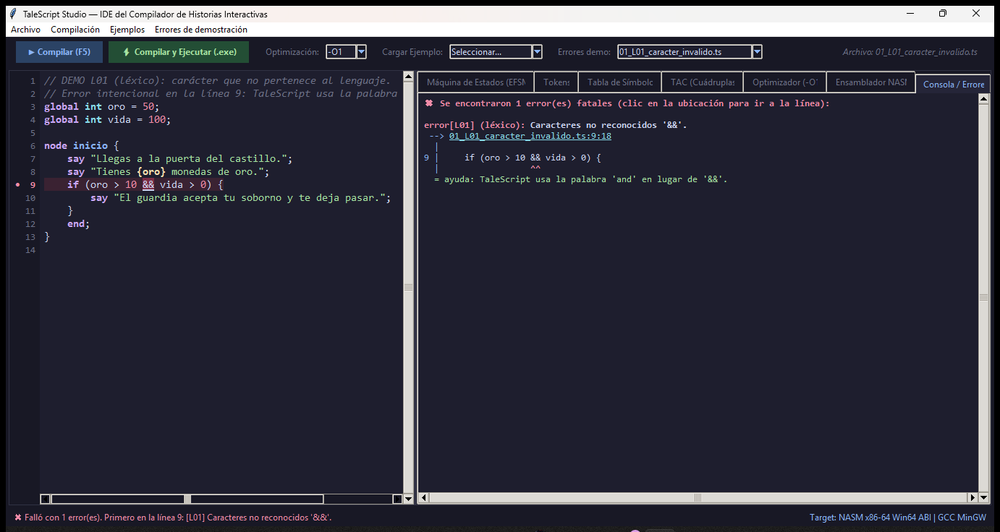 | 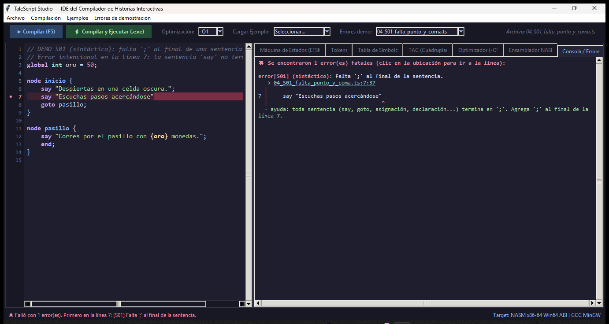 | 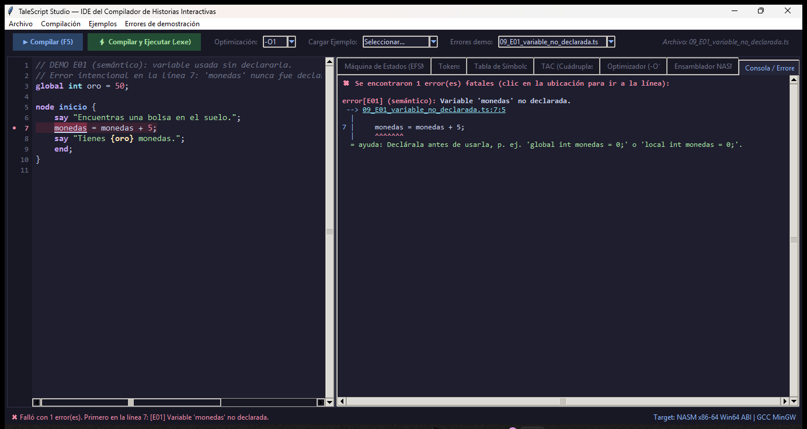 |
| 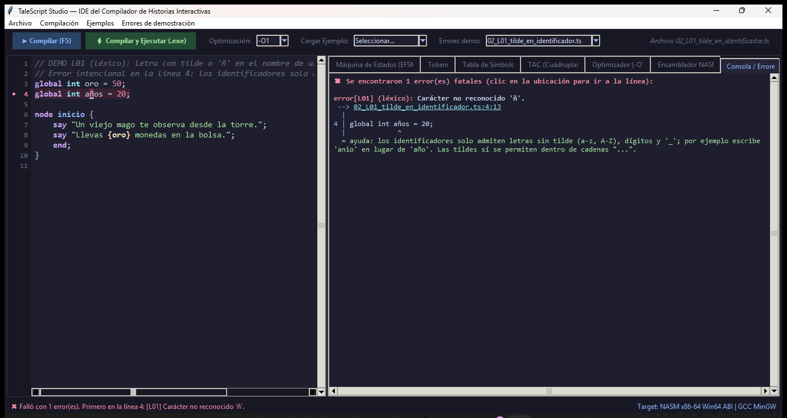 | 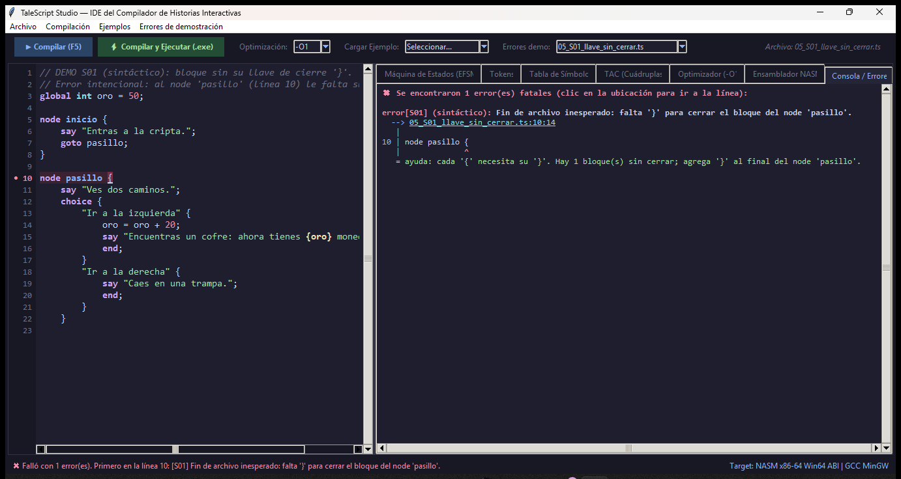 | 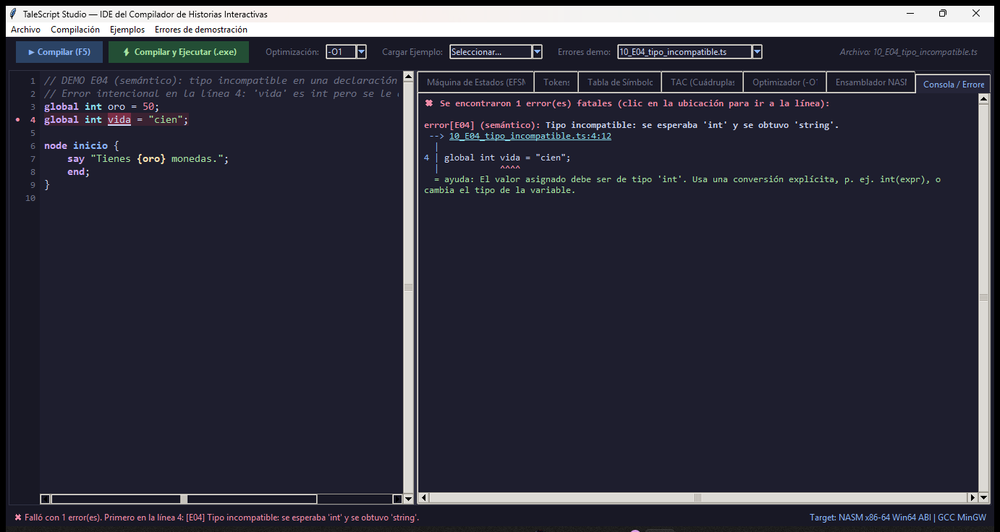 |
| 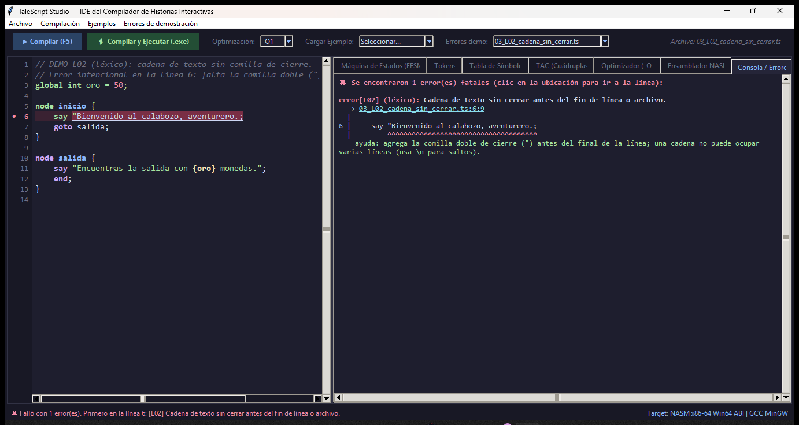 | 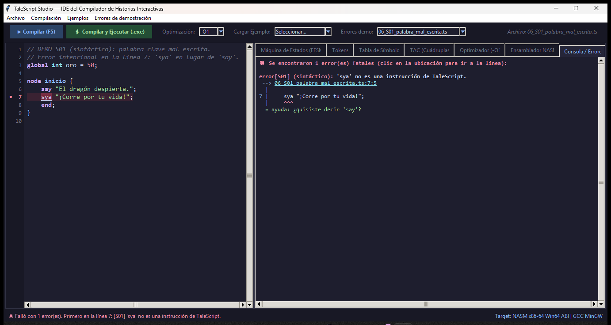 | 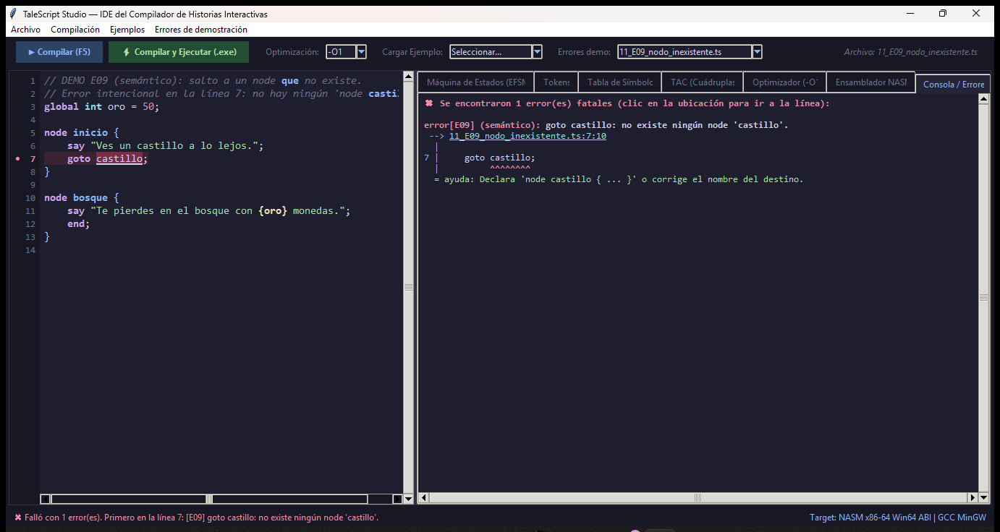 |
| | 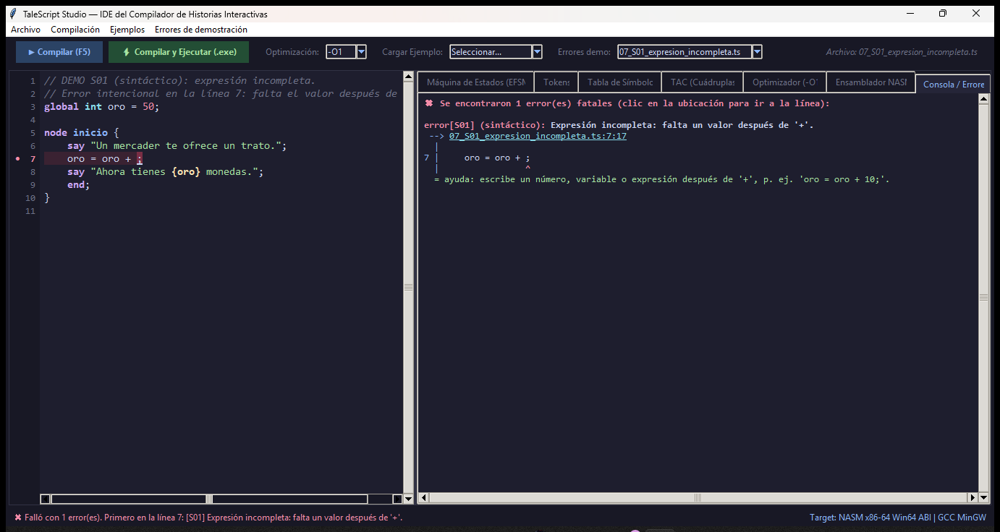 | 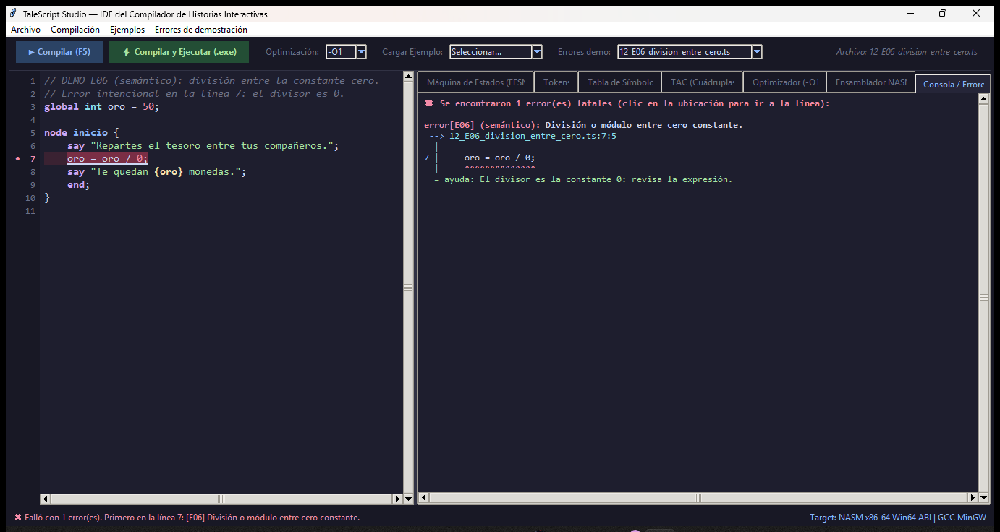 |
| | 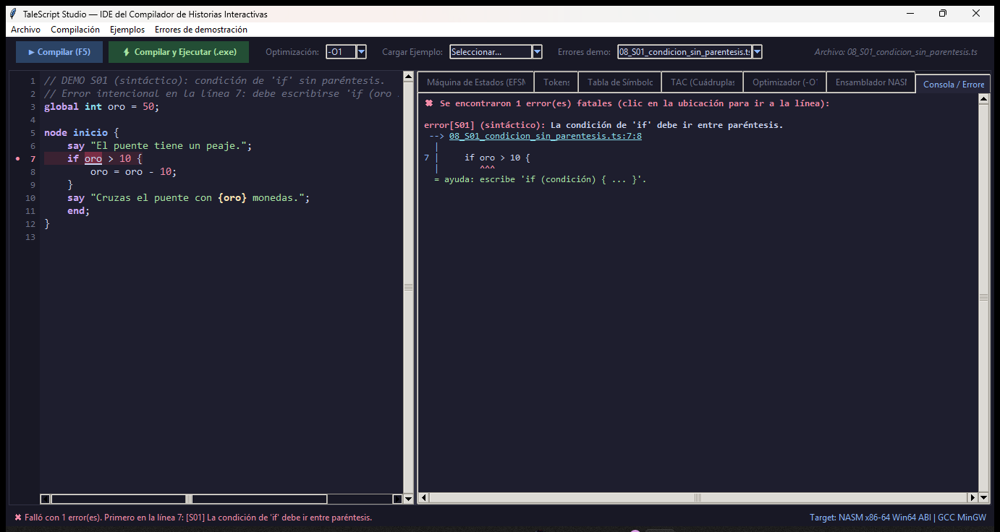 | 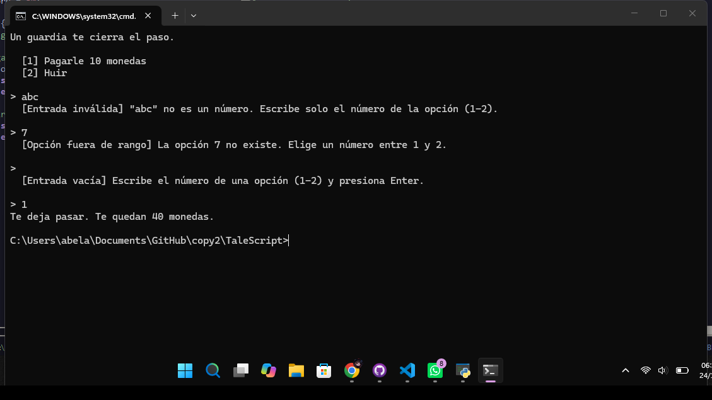 |

### 9.4. Recuperación de errores (anti-cascada)

* **Léxico:** un carácter inválido se reporta una sola vez (los caracteres seguidos como `&&` se agrupan), se omite y el análisis continúa. El error sintáctico que ese carácter provoca justo después no se reporta.
* **Sintáctico:** la gramática incluye las producciones de recuperación `sentencia : error SEMI` y `decl_global : error SEMI`. Tras un error, el parser descarta tokens hasta el siguiente `;` y no reporta errores nuevos durante los 3 tokens siguientes (modo pánico de yacc).
* **Semántico:** si hubo errores de sintaxis, se omiten las validaciones finales (node destino inexistente, variables sin usar), porque la recuperación pudo descartar sentencias y producirían errores falsos.
