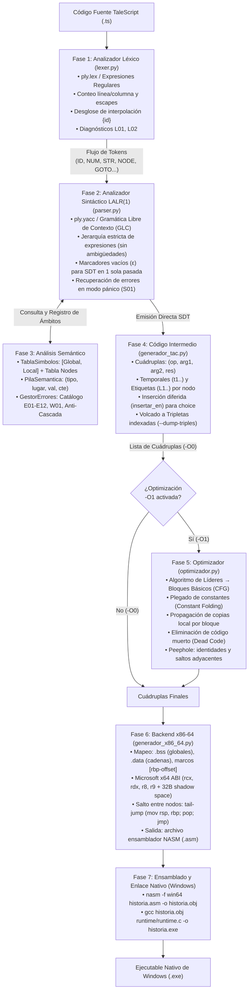

# Guía de Estudio y Defensa Técnica: Compilador TaleScript (`talescriptc`)
**Cátedra de Compiladores, Lenguajes y Autómatas**  
*Manual de Arquitectura, Recorrido Teórico-Práctico Fase por Fase y Banco de Preguntas para Examen de Defensa*

---

## 1. Visión General y Arquitectura del Compilador

### 1.1. ¿Qué es TaleScript y cuál es su objetivo?
**TaleScript** es un **Lenguaje Específico de Dominio (DSL)** diseñado formalmente para la especificación y ejecución de historias interactivas y narrativas ramificadas. Su modelo computacional subyacente es una **máquina de estados finitos extendida con variables (EFSM)**:
* Cada escena narrativa se modela como un estado discreto denominado **`node`**.
* Las transiciones entre estados se ejecutan mediante bifurcaciones incondicionales (**`goto`**), subrutinas narrativas reentrantes (**`call` / `return`**) o decisiones del usuario mediante menús de opciones (**`choice`**).
* Las variables globales (**`global`**) y locales (**`local`**) mantienen el contexto de la historia (karma, inventario, vida, contadores).

### 1.2. ¿Por qué un Compilador Nativo (AOT) hacia `.exe` en lugar de un Intérprete?
Durante el diseño de un lenguaje surgen dos caminos: la interpretación directa (árbol sintáctico / bytecode) o la compilación anticipada (*Ahead-Of-Time*, AOT) a código de máquina nativo. En TaleScript se seleccionó la **compilación nativa directa a arquitectura x86-64 (Windows PE `.exe`)** por tres razones de peso arquitectónico e ingenieril:
1. **Verificación Estricta y Detección Temprana de Errores:** En una historia interactiva grande, un jugador podría tardar dos horas en alcanzar una rama específica. Un intérprete fallaría en tiempo de ejecución al encontrar una variable mal escrita o un nodo inexistente en ese punto tardío. El compilador AOT valida exhaustivamente el 100% de los caminos, tipos y nodos mediante análisis estático antes de generar un solo byte ejecutable.
2. **Independencia de Entorno (*Zero-Dependency Distribution*):** El ejecutable binario `.exe` resultante es autónomo. No requiere que el usuario final tenga instalado Python, máquinas virtuales, intérpretes o bibliotecas externas.
3. **Eficiencia en Tiempo de Ejecución y Gestión de Memoria:** El código de máquina generado corre directamente sobre la CPU del host. La concatenación de cadenas, la gestión de marcos de activación y las comparaciones interactúan a nivel de registros de 64 bits y memoria lineal con la biblioteca en C (`runtime.c`).

---

### 1.3. Pipeline de Compilación Completo (Diagrama de Flujo)



---

### 1.4. Mapa de Archivos y Responsabilidad Modular

| Módulo / Archivo | Responsabilidad Exacta dentro del Compilador |
|---|---|
| `talescriptc/main.py` | Orquestador de la CLI (`argparse`). Lee argumentos (`-o`, `-O0/-O1`, `--dump-*`), invoca el pipeline de compilación y ejecuta los subprocesos externos (`nasm` y `gcc`). |
| `talescriptc/lexer/lexer.py` | Tokenizador basado en `ply.lex`. Convierte el texto fuente en una secuencia de tokens con seguimiento preciso de línea y columna. Identifica comentarios `//`, secuencias de escape y analiza interpolaciones de cadenas. |
| `talescriptc/parser/parser.py` | Parser LALR(1) en `ply.yacc`. Aplica la gramática formal con marcadores $\varepsilon$ que ejecutan acciones semánticas y emiten cuádruplas simultáneamente en una sola pasada. Contiene la rutina `p_error` para recuperación en modo pánico. |
| `talescriptc/semantica/tabla_simbolos.py` | Mantiene la pila de ámbitos léxicos `[Global, Local]`, el registro de nodos para resolución de referencias hacia adelante (*forward-references*) y rastrea el uso de variables para advertir variables huérfanas (`W01`). |
| `talescriptc/semantica/pila_semantica.py` | Estructura LIFO que almacena objetos `ElementoPilaSemantica(tipo, lugar, val, cte)`. Implementa las reglas de compatibilidad de tipos y la aritmética formal de 64 bits con truncamiento hacia cero. |
| `talescriptc/semantica/gestor_errores.py` | Registro centralizado de diagnósticos (`RegistroError`). Mapea los códigos `E01-E12`, `W01`, `L01-L02` y `S01`. Aplica la **política anti-cascada** suprimiendo errores derivados de operandos con tipo `ERROR`. |
| `talescriptc/intermedio/cuadrupla.py` | Define las estructuras `Cuadrupla(op, arg1, arg2, res)` y `Tripleta(indice, op, arg1, arg2)`. Provee la lógica de conversión matemática entre cuádruplas y tripletas referenciadas por índice. |
| `talescriptc/intermedio/generador_tac.py` | `GeneradorTAC` (alias `ListaCodigo`). Emite cuádruplas, gestiona los generadores de temporales (`t1..`) y etiquetas (`L1..`) reiniciados por cada nodo, mantiene el pool de cadenas `.data` e implementa la inserción posicional diferida (`insertar_en`) para menús `choice`. |
| `talescriptc/optimizador/optimizador.py` | Analiza el código intermedio dividiéndolo en grafos de bloques básicos mediante el algoritmo de líderes. Aplica optimizaciones de nivel `-O1`: *constant folding*, propagación de copias dentro del bloque básico, eliminación de código muerto y *peephole*. |
| `talescriptc/backend/generador_x86_64.py` | Generador de código NASM x86-64 compatible con la ABI de Windows (Win64). Mapea variables a `.bss`, `.data` y marcos de pila relativos a `rbp`. Implementa llamadas a C con *shadow space* y optimización de cola para saltos entre nodos. |
| `runtime/runtime.c` | Biblioteca auxiliar escrita en C ANSI. Implementa las primitivas de soporte en tiempo de ejecución: despliegue de mensajes (`_ts_say`), concatenaciones dinámicas con asignación en heap (`_ts_concat_*`), menús interactivos por consola (`_ts_exec_menu`) y aborto por división entre cero (`_ts_div_zero`). |
| `tests/execution/historia.ts` | Caso de prueba de integración de extremo a extremo que combina variables globales, locales, sentencias de impresión, interpolación, ciclos `do-while`, menús `choice` y saltos entre nodos. |

---

## 2. Recorrido Detallado Fase por Fase (Con Código Real)

---

### Fase 1 — Análisis Léxico (`talescriptc/lexer/lexer.py`)

El análisis léxico lee el flujo de caracteres del archivo fuente `.ts` y produce una secuencia de tokens atómicos descartando espacios en blanco y comentarios.

#### 1. Configuración de Palabras Reservadas y Operadores
El lexer define exactamente **22 palabras reservadas** en minúsculas en el diccionario `reserved` (Manual §7.1):
```python
reserved = {
    'node': 'NODE', 'global': 'GLOBAL', 'local': 'LOCAL', 'const': 'CONST',
    'int': 'INT', 'string': 'STRING', 'bool': 'BOOL', 'say': 'SAY',
    'goto': 'GOTO', 'call': 'CALL', 'return': 'RETURN', 'if': 'IF',
    'else': 'ELSE', 'while': 'WHILE', 'do': 'DO', 'choice': 'CHOICE',
    'end': 'END', 'and': 'AND', 'or': 'OR', 'not': 'NOT',
    'true': 'TRUE', 'false': 'FALSE',
}
```
Para evitar conflictos de prefijos (por ejemplo, reconocer `<=` antes de `<`), los tokens de dos caracteres se definen primero con reglas explícitas de mayor prioridad: `t_LE = r'<='`, `t_GE = r'>='`, `t_EQ = r'=='`, `t_NE = r'!='`.

#### 2. Seguimiento de Línea y Columna
* Las líneas se actualizan mediante la regla `t_newline(t)`: `t.lexer.lineno += len(t.value)`.
* La columna se calcula dinámicamente mediante `_find_column(input_text, token)`, buscando la posición del último salto de línea `\n` anterior a `token.lexpos`:
```python
def _find_column(input_text: str, token) -> int:
    line_start = input_text.rfind('\n', 0, token.lexpos) + 1
    return (token.lexpos - line_start) + 1
```

#### 3. Descomposición de la Interpolación de Cadenas
La regla `t_STR(t)` no devuelve simplemente un texto plano. Analiza caracteres de escape (`\n`, `\t`, `\"`, `\\`, `\{`) y busca bloques `{id}`. Si encuentra llaves, separa la cadena en una lista de tuplas estructuradas:
```python
# Entrada en el código fuente:
"Tienes {vida} puntos de vida."

# Valor producido en t.value para el parser:
["Tienes ", ('VAR', "vida"), " puntos de vida."]
```
Si se produce un error en el escape o la llave `{` no se cierra antes de terminar la cadena, la función invoca `_reportar_error_lexico('L02', ...)`.

#### 4. Errores Léxicos del Catálogo
* **`L01` (Carácter Desconocido):** Se dispara en `t_error(t)` cuando un carácter no encaja en ninguna expresión regular (por ejemplo, `@`, `$`, `#`). Se reporta la línea y columna exactas y se consume un carácter con `t.lexer.skip(1)`.
* **`L02` (Cadena Mal Formada):** Se detecta mediante la regla `t_STR_UNCLOSED` (comilla abierta que llega al salto de línea sin cerrarse) o por escapes truncados al final de una cadena.

---

### Fase 2 — Análisis Sintáctico LALR(1) y SDT (`talescriptc/parser/parser.py`)

El parser es un analizador sintáctico ascendente LALR(1) generado por `ply.yacc`. En lugar de construir un AST (Árbol de Sintaxis Abstracta) pesado en memoria y luego recorrerlo, utiliza **Traducción Dirigida por la Sintaxis (SDT) en una sola pasada**.

#### 1. Precedencia por Niveles de Producción
En lugar de depender de declaraciones globales ambiguas `precedence = (...)`, la gramática define una **jerarquía estricta de no terminales** que refleja matemáticamente la precedencia y asociatividad de operadores:

$$\text{expr} \to \text{disyunción} \ (or) \to \text{conjunción} \ (and) \to \text{igualdad} \ (==, !=) \to \text{relacional} \ (<, <=, >, >=) \to \text{aritmética} \ (+, -) \to \text{término} \ (*, /, \%) \to \text{unario} \ (neg, not) \to \text{factor}$$

Esta técnica garantiza que `ply.yacc` no genere conflictos Shift/Reduce en la evaluación de expresiones y garantiza que la multiplicación se reduzca siempre antes que la suma.

#### 2. Marcadores Vacíos ($\varepsilon$) en Parsers Ascendentes
En un parser ascendente LALR(1), las acciones semánticas convencionales solo se ejecutan **al final de una reducción** (cuando ya se leyó todo el cuerpo de la regla). Sin embargo, para estructuras de control como `if`, `while` o `choice`, el compilador debe emitir instrucciones de salto condicional **antes** de que comience el bloque de sentencias.

Para lograr esto, se insertan producciones vacías no terminales llamadas **marcadores $\varepsilon$**:
```python
def p_condicional_if(p):
    '''condicional : IF LPAREN expr RPAREN marker_if LBRACE lista_sentencias RBRACE'''
    lbl_fin = p[5]
    _gt.emitir(Cuadrupla('label', '-', '-', lbl_fin))

def p_marker_if(p):
    '''marker_if : '''
    attr = _ps.pop()  # Atributo sintetizado de la condición 'expr'
    lbl_falso = _gt.nueva_etiqueta()
    _gt.emitir(Cuadrupla('ifFalse', attr.lugar, '-', lbl_falso))
    p[0] = lbl_falso  # Pasa la etiqueta a la producción padre mediante el stack del parser
```
* **Mecánica interna:** Cuando el autómata LALR(1) reduce la producción vacía `marker_if : `, ejecuta inmediatamente el código de emisión de `ifFalse` y apila la etiqueta de destino, permitiendo que las sentencias del cuerpo se emitan en la posición secuencial correcta.

#### 3. Recuperación de Errores en Modo Pánico (`p_error`)
Cuando `ply.yacc` encuentra un token inesperado, invoca `p_error(p)`. El compilador implementa **modo pánico con sincronización léxica**:
```python
def p_error(p):
    # 1. Inspeccionar el estado del autómata para saber qué tokens se esperaban
    acciones = _parser_inst.action.get(_parser_inst.state, {})
    esperados = sorted(tok for tok in acciones.keys() if tok != '$end')
    
    # 2. Emitir diagnóstico formal S01
    _emitir_error('S01', p.lineno, columna=col, esperado=', '.join(esperados[:6]), encontrado=p.type)
    
    # 3. MODO PÁNICO: Descartar tokens del stream de entrada hasta hallar un token de sincronización
    while True:
        tok = _parser_inst.token()
        if not tok or tok.type in ('SEMI', 'RBRACE'):  # Sincroniza en ';' o '}'
            break
    _parser_inst.errok()  # Restablece el analizador para continuar parseando el resto del archivo
```
Esto evita que un simple punto y coma faltante detenga la compilación o desencadene cientos de errores falsos.

---

### Fase 3 — Análisis Semántico y Tabla de Símbolos (`tabla_simbolos.py`, `pila_semantica.py`, `gestor_errores.py`)

---

#### 1. Pila de Ámbitos: `[Global, Local]`
El compilador organiza los identificadores mediante una pila de diccionarios `pila_ambitos = [tabla_global]`:
* Al iniciar el programa, la cima es `tabla_global`. Las declaraciones `global int x = 0;` se registran aquí.
* Al entrar a un `node foo {`, se ejecuta `entrar_node('foo')`, que crea un nuevo diccionario `tabla_local` y lo apila: `pila_ambitos = [tabla_global, tabla_local_foo]`.
* Al salir del nodo (`}`), `salir_node()` desapila el entorno local, pero preserva su contenido en `EntradaNode.tabla_local` para que el backend pueda calcular el tamaño exacto del marco de pila.

#### 2. Prohibición Estricta de Sombreado (*Shadowing*, `E03`)
A diferencia de C o Java, TaleScript prohíbe que una variable local tenga el mismo nombre que una variable global para evitar errores lógicos sutiles en la narrativa:
```python
# Dentro de TablaSimbolos.insertar():
if local is not None:
    if nombre in local:
        return False  # E02: Duplicado en el mismo ámbito
    if nombre in self.tabla_global:
        self._sombreados.append(entrada)  # E03: Sombreado de una global
        return True
```
El sombreado no aborta la inserción inmediatamente para permitir que el parser continúe analizando expresiones locales, y `validar_final()` emite formalmente el error `E03`.

#### 3. Resolución de Referencias Adelantadas (*Forward-References*, `E09`)
En un guion interactivo, es natural escribir `goto pelea;` en el primer nodo antes de haber declarado el nodo `pelea` más abajo en el archivo.
* Cuando el parser encuentra `goto id` o `call id`, invoca `referenciar_nodo(id)`.
* Si el nodo aún no ha sido declarado en `tabla_nodes`, se crea una `EntradaNode(declarado=False)` y la referencia se almacena en `referencias_pendientes`.
* Al finalizar el archivo, `validar_final()` invoca `resolver_pendientes()`. Si algún nodo en la tabla quedó con `declarado == False`, se emite el error `E09` reportando la línea original del `goto`:
```text
archivo:7:0: E09: goto pelea: no existe ningún node 'pelea'.
```

#### 4. Política Anti-Cascada y Propagación del Tipo `ERROR`
Uno de los problemas más graves en compiladores novatos es el "efecto cascada": si la variable `x` no fue declarada, una expresión como `y = x + 10 * 2;` suele imprimir 5 errores distintos (variable no declarada, tipo inválido en `*`, tipo inválido en `+`, etc.).

TaleScript implementa una **política anti-cascada estricta**:
* Si un identificador no existe (`E01`), la acción semántica desapila la expresión y apila un `ElementoPilaSemantica(tipo='ERROR', lugar='_err')`.
* En cualquier reducción binaria o unaria, se consulta `gestor.error_tipo_propagado(izq.tipo, der.tipo)`:
```python
if gestor.error_tipo_propagado(izq.tipo, der.tipo):
    return ElementoPilaSemantica.error()  # Propaga ERROR silenciosamente
```
Al detectar que un operando ya es erróneo, **no se emite ningún error adicional ni se emite código intermedio**, garantizando que el usuario solo vea la causa raíz.

#### 5. Rastreo de Uso de Variables (`se_lee`, `W01`)
Cada vez que un identificador es referenciado en el lado derecho de una asignación, en una condición `if` o dentro de una interpolación `{var}`, el parser llama a `_ts.marcar_usada(nombre)`, encendiendo la bandera `entrada.se_lee = True`.
En `validar_final()`, cualquier variable local que conserve `se_lee == False` y no sea constante dispara la advertencia `W01`:
```text
archivo:5:0: W01: La variable local 'nivel' se declara pero nunca se lee.
```

---

### Fase 4 — Código Intermedio (`cuadrupla.py`, `generador_tac.py`)

---

#### 1. Anatomía de una Cuádrupla
Una cuádrupla es una instrucción normalizada de 4 campos: `(op, arg1, arg2, res)`.

| Campo | Función en TaleScript | Ejemplos |
|---|---|---|
| `op` | Operador aritmético, relacional, lógico o directiva. | `+`, `-`, `=`, `ifFalse`, `goto`, `opt`, `menu`, `say`, `call` |
| `arg1` | Primer operando (variable, temporal, literal o `-`). | `vida`, `t1`, `20`, `"Pelear"` |
| `arg2` | Segundo operando (o `-` si la operación es unaria/nula). | `5`, `t2`, `-` |
| `res` | Destino del resultado o etiqueta de salto. | `t3`, `vida`, `L1`, `_node_pelea` |

#### 2. Reinicio de Contadores de Temporales y Etiquetas por Nodo
Para mantener el código legible y acotar los marcos de pila, el `GeneradorTAC` reinicia sus contadores cada vez que entra a un nuevo nodo mediante `reiniciar_node()`:
* Los temporales `t1, t2, t3...` y las etiquetas locales `L1, L2, L3...` son **locales a cada nodo**.
* El marcador `(node, -, -, id)` delimita los límites entre nodos.
* Al cerrar el nodo, `_cerrar_node()` renumera las etiquetas en orden topológico de aparición para que el listado TAC coincida siempre con el flujo secuencial.

#### 3. Expansión de la Interpolación a Operaciones `concat`
Cuando el lexer entrega una cadena con interpolación como `["Vida: ", ('VAR', "hp")]`, el parser descompone la expresión en llamadas sucesivas al operador intermedio `concat`:
```text
1. (concat, "Vida: ", hp, t1)
2. (say, t1, -, -)
```
Si se concatenan enteros con cadenas, el backend x86-64 sabe invocar automáticamente a `_ts_concat_si` o `_ts_concat_is`.

#### 4. Inserción Diferida (`insertar_en`) en Menús `choice`
En TaleScript, la sintaxis del menú es:
```talescript
choice {
    "Pelear"   { vida = vida - 5; }
    "Perdonar" { karma = karma + 10; }
}
```
**El problema:** En tiempo de ejecución, el menú debe imprimir todas las opciones disponibles (`opt`) y solicitar la elección del usuario (`menu`) **antes** de ejecutar el código de cualquier bloque. Pero un parser ascendente descubre las opciones *a medida* que lee sus bloques internos.

**La solución:** Inserción diferida mediante `insertar_en`:
1. Al encontrar la palabra reservada `choice`, el marcador `marker_choice_ini` guarda la posición actual en la lista de cuádruplas (`pos`) y apila una tupla `(pos, Lfin)`.
2. A medida que el parser procesa cada opción `"Texto" { ... }`, emite la etiqueta de la opción `label Lk`, el código de su bloque y un salto final incondicional `goto Lfin`.
3. Al encontrar el cierre `}` del choice, `p_sent_choice` construye la lista de cuádruplas de menú:
   ```text
   (opt, "Pelear", -, L2)
   (opt, "Perdonar", -, L3)
   (menu, -, -, -)
   ```
4. Mediante `_gt.insertar_en(pos, cuadruplas_menu)`, inyecta estas instrucciones exactamente en el punto inicial donde comenzó el choice. De este modo, el menú se despliega antes de que el flujo caiga a cualquiera de las etiquetas `L2` o `L3`.

---

### Fase 5 — Optimización de Código Intermedio (`optimizador.py`)

El nivel de optimización `-O1` aplica transformaciones deterministas para reducir el número de cuádruplas y simplificar las expresiones en tiempo de compilación.

```text
Código Intermedio Original (-O0)
         │
         ▼
[1. Algoritmo de Líderes] ──▶ Partición en Bloques Básicos (CFG)
         │
         ▼
[2. Constant Folding]     ──▶ Evalúa operaciones constantes (+, -, *, ==, <...)
         │
         ▼
[3. Copy Propagation]    ──▶ Propaga asignaciones directas dentro de cada bloque
         │
         ▼
[4. Dead Code Elimination]──▶ Elimina temporales tk nunca leídos
         │
         ▼
[5. Peephole Optimizer]   ──▶ Identidades algebraicas y eliminación de saltos adyacentes
         │
         ▼
Código Intermedio Optimizado (-O1)
```

#### 1. Algoritmo de Líderes y Bloques Básicos
Un **Bloque Básico** es una secuencia lineal de instrucciones donde el flujo entra exclusivamente por la primera instrucción y sale exclusivamente por la última, sin posibilidad de bifurcación intermedia.

El método `construir_bloques()` identifica a los **líderes** siguiendo la teoría clásica de compiladores (Aho, Lam, Sethi, Ullman):
1. **Líder 1:** La primera instrucción de la lista (índice 0).
2. **Líder 2:** Cualquier instrucción que sea el objetivo de un salto condicional o incondicional (toda cuádrupla `label`).
3. **Líder 3:** Cualquier instrucción inmediatamente posterior a un salto (`goto`, `ifTrue`, `ifFalse`, `end`, `return`).

A partir de los líderes ordenados, se construyen los objetos `BloqueBasico(id)` y se conectan sus aristas de control (`sucesores` y `predecesores`).

#### 2. Plegado de Constantes (*Constant Folding*)
Si una operación aritmética o lógica tiene ambos operandos constantes conocidos (`a1` y `a2` son enteros literales), la cuádrupla se evalúa en compilación y se reemplaza por una asignación directa:
```python
# Entrada:
(+, 10, 20, t1)
# Salida optimizada:
(=, 30, -, t1)
```

#### 3. Propagación de Copias Local (*Copy Propagation*)
Si una variable o temporal se asigna a otra (`(=, a, -, b)`), los usos posteriores de `b` dentro del mismo bloque básico se reemplazan directamente por `a`.
* **Seguridad semántica:** Si la variable original `a` o el destino `b` son redefinidos en una instrucción posterior, la entrada correspondiente se invalida inmediatamente del diccionario activo de copias para evitar propagaciones corruptas.

#### 4. Eliminación de Código Muerto (*Dead Code Elimination*)
Se realiza una pasada que construye el conjunto de todos los operandos utilizados en el programa (`usados`). Si una cuádrupla calcula un temporal `tk` que nunca es leído en ninguna instrucción posterior, la cuádrupla completa se descarta de la lista de instrucciones.

#### 5. Optimización de Mirilla (*Peephole Optimizer*)
Analiza una ventana deslizante corta buscando patrones conocidos:
* **Eliminación de auto-asignaciones:** `(=, x, -, x)` se elimina.
* **Identidades de la suma:** `(+, x, 0, res)` o `(+, 0, x, res)` $\to$ `(=, x, -, res)`.
* **Identidades del producto:** `(*, x, 1, res)` $\to$ `(=, x, -, res)` y `(*, x, 0, res)` $\to$ `(=, 0, -, res)`.
* **Identidades de la resta:** `(-, x, 0, res)` $\to$ `(=, x, -, res)`.
* **Eliminación de saltos a la instrucción siguiente:**
  ```text
  (goto, -, -, L1)
  (label, -, -, L1)
  ```
  El `goto` salta exactamente a la línea siguiente; por ende, se suprime.

---

### Fase 6 — Backend x86-64 y Runtime (`generador_x86_64.py`, `runtime.c`)

---

#### 1. Mapeo del Modelo de Memoria en Ensamblador NASM
El backend organiza la memoria en tres secciones estándar:
* **Sección `.data` (Constantes y Literales):** Almacena las cadenas de caracteres inmutables registradas en el pool `_cadenas`. Se emiten con terminación nula (`0`):
  ```nasm
  section .data
      _str_vacio db 0
      S0 db "Despiertas en un lugar oscuro.", 0
      S1 db "Pelear", 0
  ```
* **Sección `.bss` (Variables Globales Estáticas):** Reserva memoria no inicializada en el espacio global mediante la directiva `resq 1` (8 bytes por variable de 64 bits):
  ```nasm
  section .bss
      _glob_karma resq 1
      _glob_asesinatos resq 1
  ```
  Se direccionan en modo relativo al puntero de instrucciones: `[rel _glob_karma]`.
* **Sección `.text` (Pila para Locales y Temporales):** Las variables locales y temporales residen exclusivamente en el marco de activación de la función del nodo actual, indexadas negativamente respecto al registro base: `[rbp - 8]`, `[rbp - 16]`, etc.

---

#### 2. Cumplimiento Estricto de la Microsoft x64 ABI (Windows Calling Convention)
Para que el código ensamblador generado pueda enlazar y llamar sin fallos de segmentación (*segfaults*) a las funciones de `runtime.c` compiladas con GCC/MinGW-w64, se implementan tres reglas obligatorias de la ABI de Windows:

1. **Paso de Parámetros en Registros:**
   * 1.er argumento: **`rcx`**
   * 2.º argumento: **`rdx`**
   * 3.er argumento: **`r8`**
   * 4.º argumento: **`r9`**
   * Valor de retorno (enteros/punteros): **`rax`**

2. **Reserva Obligatoria de *Shadow Space* (Home Space):**
   Antes de emitir cualquier instrucción `call`, la función llamadora **debe reservar al menos 32 bytes (4 quadwords de 8 bytes)** en la cima de la pila (`sub rsp, 32`). Este espacio está reservado para que la función llamada en C pueda volcar sus registros `rcx, rdx, r8, r9` a memoria si requiere compilación sin optimización o depuración.

3. **Alineación de Pila a 16 Bytes:**
   La arquitectura x86-64 de Windows exige que inmediatamente antes de ejecutarse una instrucción `call`, el registro `rsp` sea **estrictamente divisible entre 16** (`rsp % 16 == 0`).
   * Al entrar a una función, la instrucción `call` del llamador ya introdujo la dirección de retorno de 8 bytes en la pila (`rsp % 16 == 8`).
   * El prólogo ejecuta `push rbp` (otros 8 bytes), volviendo a alinear la pila a 16 bytes.
   * Por lo tanto, el tamaño reservado para variables locales, temporales y el shadow space **debe ser un múltiplo exacto de 16**:
     $$\text{frame\_size} = (\text{offset\_variables} + 32 + 15) \ \& \ \sim 15$$

---

#### 3. Diferencia Crítica: `call` vs `return` vs `goto` entre Nodos
Esta es una de las decisiones de diseño más elegantes del compilador TaleScript:

| Operación | Instrucciones Generadas en Ensamblador | Efecto en la Pila y Flujo |
|---|---|---|
| **`call nodo`** | `call _node_nodo` | Crea un nuevo marco de activación en la pila. La subrutina ejecutará su código y volverá al punto de invocación mediante `ret`. Usado para subrutinas y diálogos reentrantes. |
| **`return`** | `jmp .epilogo_actual`<br/>`mov rsp, rbp`<br/>`pop rbp`<br/>`ret` | Desarma el marco de activación local, restaura el puntero `rbp` del llamador y retorna a la dirección guardada en la pila. |
| **`goto nodo`**<br/>*(Salto entre nodos)* | `mov rsp, rbp`<br/>`pop rbp`<br/>`jmp _node_destino` | **Optimización de Salto de Cola (*Tail-Jump*):** Desarma completamente el marco de pila del nodo actual y salta mediante `jmp` al siguiente nodo. **No consume memoria en la pila.** |

> **Importancia en Historias Interactivas:** Si `goto pelea;` usara un `call` convencional, una historia donde el jugador recorra 100 escenas acumularía 100 marcos de activación sin cerrar en la pila de llamadas, agotando la memoria (*stack overflow*). Al destruir el marco actual con `mov rsp, rbp; pop rbp` antes de saltar con `jmp`, la historia puede transicionar indefinidamente entre miles de nodos manteniendo una profundidad de pila constante de nivel 1 respecto a `main`.

---

#### 4. Rol de las Primitivas del Runtime en C (`runtime/runtime.c`)
* `void _ts_say(const char *text)`: Recibe el puntero a la cadena en `rcx`. Imprime con `printf("%s\n", text)` y ejecuta `fflush(stdout)` inmediato para evitar buffering en la terminal.
* `const char* _ts_int_to_str(int64_t i)`: Reserva memoria con `malloc` y formatea un entero de 64 bits con `snprintf("%lld")`.
* `const char* _ts_concat_ss/si/is(...)`: Gestiona la concatenación dinámica. Mide las longitudes con `strlen`, reserva el bloque de memoria exacto (`malloc(la + lb + 1)`) y copia los bytes.
* `int64_t _ts_streq(const char *a, const char *b)`: Compara punteros y contenidos (`strcmp`). Devuelve 1 si son idénticos o 0 si difieren.
* `void _ts_add_opt(const char *text)`: Registra una opción de texto en el arreglo global `_menu_opts` e incrementa `_menu_count`.
* `int64_t _ts_exec_menu(void)`: Despliega en pantalla el menú formateado (`[1] Pelear`, `[2] Perdonar...`), lee y valida la respuesta del usuario con `scanf("%d")` en un ciclo cerrado contra errores, reinicia el contador de menú a cero y devuelve el índice elegido normalizado a base 0 (`choice - 1`) en el registro `rax`.
* `void _ts_div_zero(void)`: Manejador de interrupción por software. Si el ensamblador detecta un divisor nulo en operaciones `/` o `%`, salta aquí, imprime un mensaje de error fatal en `stderr` y termina con código de salida 1.
* `void _ts_exit(void)`: Termina limpiamente el proceso con código 0.

---

## 3. Trazabilidad Completa de un Ejemplo Real (`tests/execution/historia.ts`)

A continuación se demuestra la trazabilidad matemática y estructural completa del código fuente de `historia.ts` a través de todas las fases del compilador.

### 3.1. Código Fuente Original (`tests/execution/historia.ts`)
```talescript
global int karma = 0;
global int asesinatos = 0;

node inicio {
    local int nivel = 1;
    say "Despiertas en un lugar oscuro.";
    goto pelea;
}

node pelea {
    local bool terminado = false;
    local int vida = 20;
    do {
        choice {
            "Pelear" { vida = vida - 5; asesinatos = asesinatos + 1; }
            "Perdonar" { karma = karma + 10; terminado = true; }
            "Huir" { terminado = true; }
        }
    } while (not terminado);
    if (karma < 0 or asesinatos >= 10) { say "Te teme."; }
    end;
}
```

---

### 3.2. Salida del Tokenizador (`--dump-tokens`)
El lexer lee los caracteres y produce la siguiente secuencia (extracto del nodo `inicio`):

```text
Tipo            Valor                               Línea  Pos
--------------------------------------------------------------
GLOBAL          global                              1      0
INT             int                                 1      7
ID              karma                               1      11
ASSIGN          =                                   1      17
NUM             0                                   1      19
SEMI            ;                                   1      20
...
NODE            node                                4      50
ID              inicio                              4      55
LBRACE          {                                   4      62
LOCAL           local                               5      68
INT             int                                 5      74
ID              nivel                               5      78
ASSIGN          =                                   5      84
NUM             1                                   5      86
SEMI            ;                                   5      87
SAY             say                                 6      93
STR             ['Despiertas en un lugar oscuro.']  6      97
SEMI            ;                                   6      129
GOTO            goto                                7      135
ID              pelea                               7      140
SEMI            ;                                   7      145
RBRACE          }                                   8      147
```

---

### 3.3. Estado de la Tabla de Símbolos (`--dump-symtab`)
El análisis semántico clasifica las variables y resuelve las referencias:

```text
Tabla global
Nombre           Tipo    Ámbito  Dir.  Línea  Valor inic.    ¿Se lee?
---------------------------------------------------------------------
karma            int     global  G0    1      0              sí
asesinatos       int     global  G1    2      0              sí

Tabla local del node inicio
Nombre           Tipo    Ámbito  Dir.  Línea  Valor inic.    ¿Se lee?
---------------------------------------------------------------------
nivel            int     local   L0    5      1              no

Tabla local del node pelea
Nombre           Tipo    Ámbito  Dir.  Línea  Valor inic.    ¿Se lee?
---------------------------------------------------------------------
terminado        bool    local   L0    11     false          sí
vida             int     local   L1    12     20             sí

Tabla de nodes
Node             Línea  Observación
----------------------------------------------------------------------
inicio           4      Punto de entrada: es el primer node del archivo.
pelea            10     Referenciado por goto pelea (línea 4, node inicio) antes de ser declarado.

5:0: W01: La variable local 'nivel' se declara pero nunca se lee.
0 error(es), 1 aviso(s).
```

---

### 3.4. Código Intermedio en Cuádruplas (`--dump-tac`)

#### Nodo `inicio`:
```text
node inicio  (4 cuádruplas)
   #  Cuádrupla                                    Comentario
----------------------------------------------------------------------
   1  (=, 1, -, nivel)
   2  (say, "Despiertas en un lugar oscuro.", -, -)
   3  (goto, -, -, pelea)
   4  (return, -, -, -)
```

#### Nodo `pelea` (Nótese cómo `opt` y `menu` fueron inyectados en la cima del ciclo `do-while`):
```text
node pelea  (31 cuádruplas)
   #  Cuádrupla                                    Comentario
----------------------------------------------------------------------
   1  (=, false, -, terminado)
   2  (=, 20, -, vida)
   3  (label, -, -, L1)                            ; Inicio del do-while
   4  (opt, "Pelear", -, L2)                       ; Inserción diferida de choice
   5  (opt, "Perdonar", -, L3)
   6  (opt, "Huir", -, L4)
   7  (menu, -, -, -)                              ; Despliegue de menú y selección
   8  (label, -, -, L2)                            ; Bloque opción 1
   9  (-, vida, 5, t1)
  10  (=, t1, -, vida)
  11  (+, asesinatos, 1, t2)
  12  (=, t2, -, asesinatos)
  13  (goto, -, -, L5)                             ; Salto a la salida del choice
  14  (label, -, -, L3)                            ; Bloque opción 2
  15  (+, karma, 10, t3)
  16  (=, t3, -, karma)
  17  (=, true, -, terminado)
  18  (goto, -, -, L5)
  19  (label, -, -, L4)                            ; Bloque opción 3
  20  (=, true, -, terminado)
  21  (label, -, -, L5)                            ; Salida común del choice
  22  (not, terminado, -, t4)                      ; Condición do-while (not terminado)
  23  (ifTrue, t4, -, L1)                          ; Repite si es verdadero
  24  (<, karma, 0, t5)                            ; Evaluación if (karma < 0 or asesinatos >= 10)
  25  (>=, asesinatos, 10, t6)
  26  (or, t5, t6, t7)
  27  (ifFalse, t7, -, L6)
  28  (say, "Te teme.", -, -)
  29  (label, -, -, L6)
  30  (end, -, -, -)                               ; Fin del juego
  31  (return, -, -, -)
```

---

### 3.5. Comparación TAC: Cuádruplas vs Tripletas (`--dump-triples`)
En el formato de tripletas, el resultado de cada cálculo intermedio no tiene nombre explícito, sino que se referencia por el número de instrucción `(i)`:

```text
node inicio
    #  Tripleta                                 Comentario
----------------------------------------------------------------------
  (0)  (=, nivel, 1)
  (1)  (say, "Despiertas en un lugar oscuro.", -)
  (2)  (goto, pelea, -)
  (3)  (return, -, -)

node pelea
    #  Tripleta                                 Comentario
----------------------------------------------------------------------
  (0)  (=, terminado, false)
  (1)  (=, vida, 20)
  (2)  (opt, "Pelear", (6))
  (3)  (opt, "Perdonar", (11))
  (4)  (opt, "Huir", (15))
  (5)  (menu, -, -)
  (6)  (-, vida, 5)
  (7)  (=, vida, (6))                           ; vida toma el resultado de (6)
  (8)  (+, asesinatos, 1)
  (9)  (=, asesinatos, (8))                     ; asesinatos toma el resultado de (8)
 (10)  (goto, (16), -)
 ...
```

---

### 3.6. Código Ensamblador NASM Generado (`generador_x86_64.py`)
A continuación se presenta el ensamblador nativo real generado para Windows x64:

```nasm
; =====================================================================
; TaleScript — Código ensamblador generado por talescriptc
; Objetivo: NASM x86-64 Windows (Microsoft x64 ABI)
; =====================================================================
default rel

section .data
    _str_vacio db 0
    S0 db "Despiertas en un lugar oscuro.", 0
    S1 db "Pelear", 0
    S2 db "Perdonar", 0
    S3 db "Huir", 0
    S4 db "Te teme.", 0

section .bss
    _glob_karma resq 1
    _glob_asesinatos resq 1

section .text
    extern _ts_say
    extern _ts_int_to_str
    extern _ts_concat_ss
    extern _ts_concat_si
    extern _ts_concat_is
    extern _ts_streq
    extern _ts_add_opt
    extern _ts_exec_menu
    extern _ts_div_zero
    extern _ts_exit
    global main

main:
    push rbp
    mov rbp, rsp
    sub rsp, 32                         ; Shadow space de 32 bytes para Win64
    mov qword [rel _glob_karma], 0      ; Inicialización de globales
    mov qword [rel _glob_asesinatos], 0
    call _node_inicio                   ; Entra a la historia
    add rsp, 32
    pop rbp
    xor eax, eax
    ret

_node_inicio:
    push rbp
    mov rbp, rsp
    sub rsp, 48                         ; Marco alineado a 16 bytes: (8 vars + 32 shadow + 15) & ~15 = 48
    mov qword [rbp - 8], 0              ; nivel = 0 por defecto
    mov rax, 1
    mov [rbp - 8], rax                  ; nivel = 1
    lea rcx, [rel S0]                   ; 1.er argumento en rcx para Win64 ABI
    call _ts_say                        ; Llama a la primitiva en C
    mov rsp, rbp                        ; TAIL-JUMP: Destruye el marco actual antes de saltar
    pop rbp
    jmp _node_pelea                     ; Transición de estado sin apilar marcos
    jmp .epilogo_inicio
.epilogo_inicio:
    mov rsp, rbp
    pop rbp
    ret

_node_pelea:
    push rbp
    mov rbp, rsp
    sub rsp, 112                        ; Marco calculado para 5 variables/temporales + shadow space
    mov qword [rbp - 8], 0              ; terminado = false
    mov qword [rbp - 16], 0             ; vida = 0
    mov rax, 0
    mov [rbp - 8], rax
    mov rax, 20
    mov [rbp - 16], rax
.L1:                                    ; Etiqueta inicio do-while
    lea rcx, [rel S1]                   ; Registrar opción "Pelear"
    call _ts_add_opt
    lea rcx, [rel S2]                   ; Registrar opción "Perdonar"
    call _ts_add_opt
    lea rcx, [rel S3]                   ; Registrar opción "Huir"
    call _ts_add_opt
    call _ts_exec_menu                  ; Ejecuta el menú; rax recibe el índice elegido (0, 1 o 2)
    cmp rax, 0
    je .L2
    cmp rax, 1
    je .L3
    cmp rax, 2
    je .L4
.L2:                                    ; Opción "Pelear"
    mov rax, [rbp - 16]
    mov rcx, 5
    sub rax, rcx
    mov [rbp - 24], rax                 ; t1 = vida - 5
    mov rax, [rbp - 24]
    mov [rbp - 16], rax                 ; vida = t1
    mov rax, [rel _glob_asesinatos]
    mov rcx, 1
    add rax, rcx
    mov [rbp - 32], rax                 ; t2 = asesinatos + 1
    mov rax, [rbp - 32]
    mov [rel _glob_asesinatos], rax
    jmp .L5
.L3:                                    ; Opción "Perdonar"
    mov rax, [rel _glob_karma]
    mov rcx, 10
    add rax, rcx
    mov [rbp - 40], rax
    mov rax, [rbp - 40]
    mov [rel _glob_karma], rax
    mov rax, 1
    mov [rbp - 8], rax                  ; terminado = true
    jmp .L5
.L4:                                    ; Opción "Huir"
    mov rax, 1
    mov [rbp - 8], rax                  ; terminado = true
.L5:                                    ; Salida común del choice
    mov rax, [rbp - 8]
    xor rax, 1                          ; Operación NOT booleano
    mov [rbp - 48], rax
    mov rax, [rbp - 48]
    test rax, rax
    jnz .L1                             ; ifTrue t4 goto L1 (repite ciclo)
    mov rax, [rel _glob_karma]
    mov rcx, 0
    cmp rax, rcx
    setl al                             ; karma < 0
    movzx rax, al
    mov [rbp - 56], rax
    mov rax, [rel _glob_asesinatos]
    mov rcx, 10
    cmp rax, rcx
    setge al                            ; asesinatos >= 10
    movzx rax, al
    mov [rbp - 64], rax
    mov rax, [rbp - 56]
    mov rcx, [rbp - 64]
    or rax, rcx                         ; t5 or t6
    mov [rbp - 72], rax
    mov rax, [rbp - 72]
    test rax, rax
    jz .L6                              ; ifFalse t7 goto L6
    lea rcx, [rel S4]
    call _ts_say                        ; say "Te teme."
.L6:
    xor ecx, ecx
    call _ts_exit                       ; end: Termina el juego
```

---

## 4. Guía Práctica de Comandos CLI para Demostración en Vivo

Durante una sustentación oral o presentación técnica, ejecute estos comandos directamente en **PowerShell** en la raíz del proyecto para demostrar cada una de las fases del compilador en tiempo real:

### 1. Demostración del Analizador Léxico (Tokens y Coordenadas)
Muestra la lista de tokens generados, identificando tipos, lexemas, líneas y posiciones de inicio:
```powershell
python -m talescriptc tests/execution/historia.ts --dump-tokens
```

### 2. Demostración del Análisis Semántico (Tabla de Símbolos y Ámbitos)
Muestra la tabla de variables globales, las tablas locales por nodo con direcciones de memoria asignadas (`G0`, `L0`), la bandera de lectura `se_lee` y la tabla de nodos con referencias cruzadas:
```powershell
python -m talescriptc tests/execution/historia.ts --dump-symtab
```

### 3. Demostración del Código Intermedio en Cuádruplas (-O0)
Imprime las cuádruplas `(op, arg1, arg2, res)` en orden secuencial sin optimizar:
```powershell
python -m talescriptc tests/execution/historia.ts --dump-tac -O0
```

### 4. Demostración del Código Intermedio en Tripletas
Muestra la representación abstracta sin asignación de nombres de temporales, referenciada por índice `(i)`:
```powershell
python -m talescriptc tests/execution/historia.ts --dump-triples
```

### 5. Demostración del Optimizador (-O1)
Compara el código antes y después de aplicar *constant folding*, propagación de copias y eliminación de código muerto:
```powershell
python -m talescriptc tests/execution/historia.ts --dump-tac -O1
```

### 6. Compilación Completa a Binario Ejecutable Nativo (`.exe`)
Compila el archivo `.ts`, genera el ensamblador NASM temporal, invoca a `nasm -f win64` y enlaza con `gcc` y `runtime/runtime.c`:
```powershell
python -m talescriptc tests/execution/historia.ts -o historia.exe -O1
```

### 7. Ejecución de la Historia Compilada
Ejecuta directamente el archivo binario generado en la terminal de Windows:
```powershell
.\historia.exe
```

---

## 5. Banco de Preguntas y Respuestas de Defensa Técnica (Examen Oral)

A continuación se presentan 10 preguntas de alta profundidad conceptual que suelen formular jurados y profesores de compiladores, con sus respuestas técnicas basadas fielmente en el código del repositorio:

---

### P1. ¿Por qué la sentencia `goto` entre nodos no utiliza la instrucción `call` de x86-64 en ensamblador?
**Respuesta:**  
Porque los `node` en TaleScript modelan estados de una máquina de estados finitos donde las historias pueden tener cientos o miles de transiciones secuenciales continuas. Si el compilador tradujera `goto otro_nodo` a un `call _node_otro_nodo`, cada salto introduciría una nueva dirección de retorno de 8 bytes y un marco de activación completo en la pila de llamadas. En una sesión de juego prolongada, esto provocaría inevitablemente un desbordamiento de pila (*Stack Overflow*).  
Por ello, en `generador_x86_64.py` (líneas 398–403), el compilador implementa una **optimización de salto de cola (*Tail-Call/Tail-Jump*)**:
```nasm
mov rsp, rbp    ; Deshace el marco de pila actual
pop rbp         ; Restaura el puntero base anterior
jmp _node_pelea ; Salta directamente al nuevo nodo sin consumir pila
```
De esta manera, la profundidad de la pila se mantiene constante en 1 respecto a la función `main`, garantizando ejecución infinita sin riesgo de agotar la memoria.

---

### P2. ¿Cómo resuelve el parser ascendente LALR(1) la generación de código para un menú `choice` si las opciones deben presentarse en pantalla antes de que comiencen sus respectivos bloques de sentencias?
**Respuesta:**  
Se resuelve mediante el mecanismo de **inserción diferida (*Deferred Insertion*)** provisto por `GeneradorTAC.insertar_en()`.  
Al encontrar la palabra clave `choice`, la acción semántica `marker_choice_ini` consulta la posición actual en la lista lineal de cuádruplas (`pos = _gt.pos_actual()`) y la almacena en una pila de choices. El parser continúa leyendo normalmente cada opción `"Texto" { sentencias }`, emitiendo la etiqueta de la opción y sus sentencias asociadas. Al llegar al cierre `}` del bloque choice, la regla `p_sent_choice` construye la lista de cuádruplas correspondientes al menú (`opt "Op1", L1`, `opt "Op2", L2`, `menu`) y las inyecta retrospectivamente en la posición `pos` guardada previamente. Esto garantiza que el menú se imprima y consulte la decisión del usuario en tiempo de ejecución antes de saltar a las etiquetas de los bloques.

---

### P3. ¿Qué exigencias críticas impone la Microsoft x64 ABI para poder enlazar ensamblador con la biblioteca `runtime.c`, y cómo las satisface el compilador?
**Respuesta:**  
La ABI de Microsoft para arquitecturas de 64 bits en Windows impone tres requisitos mandatorios que el backend `generador_x86_64.py` implementa con exactitud:
1. **Convención de Paso de Argumentos:** Los cuatro primeros parámetros enteros o punteros no se pasan en la pila, sino en los registros específicos: 1.º en `rcx`, 2.º en `rdx`, 3.º en `r8` y 4.º en `r9`. El valor retornado por la función en C se recoge en `rax`.
2. **Reserva de *Shadow Space* (32 bytes):** La función llamadora debe reservar obligatoriamente 32 bytes (4 palabras de 64 bits) en la cima de la pila justo antes de emitir la instrucción `call`, independientemente del número de parámetros.
3. **Alineación de Pila a 16 Bytes:** En el momento exacto en que se ejecuta `call`, el registro `rsp` debe ser divisible entre 16 (`rsp % 16 == 0`). El generador calcula el tamaño del marco de pila de cada nodo aplicando la fórmula de alineación con redondeo hacia arriba:
   $$\text{frame\_size} = (\text{offset\_variables} + 32 + 15) \ \& \ \sim 15$$

---

### P4. ¿Cómo evita el compilador emitir una "cascada" de errores falsos cuando una variable no ha sido declarada?
**Respuesta:**  
Mediante la **propagación del tipo centinela `ERROR`** en el gestor de errores y en la pila semántica (Manual §3.4).  
Cuando un identificador no se encuentra en la tabla de símbolos, `gestor_errores.py` reporta el error `E01` exactamente una vez y apila un elemento sintético con `tipo = 'ERROR'`. En cualquier operación subsecuente (por ejemplo, en sumas, productos o asignaciones), las funciones semánticas consultan `gestor.error_tipo_propagado(izq.tipo, der.tipo)`. Si al menos uno de los operandos posee el tipo `ERROR`, la operación simplemente propaga `ERROR` hacia arriba en el árbol sin emitir nuevos mensajes diagnósticos y sin generar código intermedio.

---

### P5. ¿Por qué se utilizan marcadores vacíos ($\varepsilon$) en lugar de esperar al cierre de la producción sintáctica en `if`, `while` o `do-while`?
**Respuesta:**  
En un parser ascendente LALR(1) como `ply.yacc`, una producción estándar solo ejecuta su código semántico cuando el analizador realiza la **reducción final** (tras consumir todos los tokens de la regla).  
Para estructuras condionales como `if (cond) { bloque }`, la instrucción de salto condicional `ifFalse t1, -, L_fin` debe estar colocada físicamente en el código intermedio **antes** de las instrucciones del `bloque`. La inserción de un no-terminal vacío intermedio (`marker_if : `) fuerza al autómata a realizar una reducción $\varepsilon$ justo en ese instante intermedio, permitiendo emitir la cuádrupla de salto y registrar la etiqueta en la pila antes de proceder al análisis de las sentencias interiores del bloque.

---

### P6. ¿Cómo resuelve el compilador una referencia adelantada cuando un nodo salta a otro que aún no ha sido declarado en el archivo fuente?
**Respuesta:**  
Se gestiona mediante la estructura de dos fases de la `TablaSimbolos`:
1. Cuando se encuentra una sentencia `goto pelea;` en el nodo `inicio`, la tabla busca si el nodo `pelea` ya existe en `tabla_nodes`. Si no existe, crea una `EntradaNode(nombre='pelea', declarado=False)` y anota la línea y el nodo de origen en una lista de `referencias_pendientes`.
2. Cuando el parser alcanza más adelante la cabecera `node pelea {`, invoca `entrar_node('pelea')`, lo que actualiza la entrada marcando `declarado = True` y fijando su línea real de definición.
3. Al finalizar el análisis de todo el archivo fuente, el parser ejecuta `validar_final()`, que recorre todas las `referencias_pendientes`. Si algún nodo quedó con `declarado == False`, se emite formalmente el error `E09`, reportando la línea exacta del `goto` huérfano.

---

### P7. ¿Por qué TaleScript prohíbe el sombreado (*shadowing*) de variables globales por parte de variables locales (Error `E03`)?
**Respuesta:**  
En historias interactivas complejas, las variables globales representan el estado trascendente de la partida (como la cordura, la vida total o decisiones del argumento). Si un programador declara dentro de un nodo una variable local con el mismo nombre `local int karma = 5;`, en lenguajes como C la variable local ocultaría a la global silenciosamente. Esto suele provocar que el autor modifique la variable local creyendo alterar el estado global de la historia, introduciendo defectos de lógica argumental muy difíciles de depurar. Para prevenir este problema desde la raíz del diseño del lenguaje, la `TablaSimbolos` compara activamente cada nueva variable local contra `tabla_global`, emitiendo el error semántico fatal `E03`.

---

### P8. ¿Qué criterio utiliza el optimizador para dividir una lista plana de cuádruplas en Bloques Básicos?
**Respuesta:**  
Utiliza el **Algoritmo de Identificación de Líderes** (Manual §5.1 / Aho et al.). Una instrucción en la lista de cuádruplas se clasifica como líder si cumple cualquiera de estas tres condiciones:
1. Es la primera instrucción del código intermedio (índice 0).
2. Es el destino de una instrucción de salto condicional o incondicional (toda cuádrupla con operador `label`).
3. Es la instrucción que sigue inmediatamente a una bifurcación o salto (`goto`, `ifTrue`, `ifFalse`, `return`, `end`, `menu`).

Una vez determinados todos los líderes y ordenados por su índice secuencial, cada bloque básico queda delimitado desde un líder hasta la instrucción inmediatamente anterior al siguiente líder (o el final del código). Esto garantiza que ningún bloque tenga puntos de entrada o salida intermedios.

---

### P9. ¿En qué consiste la optimización de mirilla (*peephole*) implementada y qué patrones específicos detecta en el proyecto?
**Respuesta:**  
La optimización de mirilla es una técnica de optimización local que examina una ventana corta contigua de instrucciones intermedias para reemplazar patrones ineficientes por equivalentes semánticos más rápidos o compactos. En `optimizador.py` (método `_peephole`), se implementan cuatro patrones principales:
1. **Eliminación de auto-asignaciones:** Asignaciones redundantes de la forma `(=, x, -, x)` se suprimen.
2. **Identidades aditivas:** `(+, x, 0, r)` o `(+, 0, x, r)` se reemplazan por una asignación simple `(=, x, -, r)`. Lo mismo aplica para la resta `(-, x, 0, r)`.
3. **Identidades multiplicativas:** `(*, x, 1, r)` se simplifica a `(=, x, -, r)` y `(*, x, 0, r)` se simplifica a la constante cero `(=, 0, -, r)`.
4. **Eliminación de saltos contiguos:** Si una cuádrupla `(goto, -, -, L)` está inmediatamente seguida de `(label, -, -, L)`, el salto es superfluo porque el flujo caería de forma natural en la etiqueta, por lo que el `goto` se elimina.

---

### P10. ¿Por qué las cadenas de caracteres se asignan dinámicamente en el Heap mediante `malloc` dentro de `runtime.c` durante las concatenaciones?
**Respuesta:**  
Porque en TaleScript las cadenas son dinámicas y de longitud variable en tiempo de ejecución (especialmente cuando se combinan mediante interpolación con enteros o elecciones del usuario).  
Si el runtime utilizara buffers estáticos fijos en la memoria de la pila, existirían dos riesgos graves:
1. Riesgo de vulnerabilidad de seguridad o corrupción de memoria por desbordamiento de búfer (*Buffer Overflow*) si el texto compuesto supera la capacidad del arreglo.
2. Incompatibilidad de persistencia: si una función retornara un puntero a una variable local en la pila de C, al retornar la función ese marco de pila quedaría invalidado, corrompiendo el contenido del texto.  
Al utilizar `malloc(la + lb + 1)` en `_ts_concat_ss`, `_ts_concat_si` e `_ts_concat_is`, el runtime garantiza que el nuevo bloque de texto resida en el Heap de forma persistente y segura durante todo el ciclo de vida de la ejecución.
